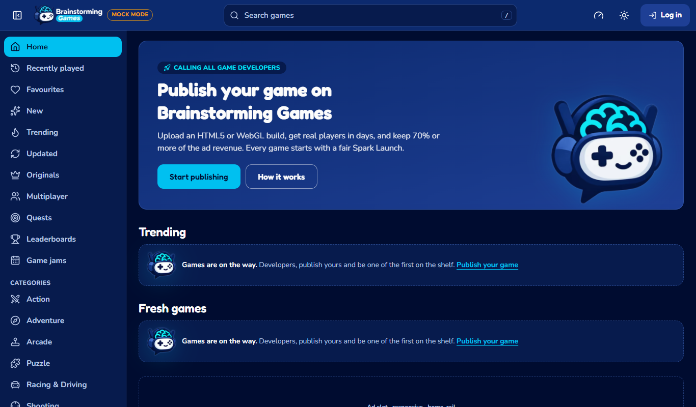
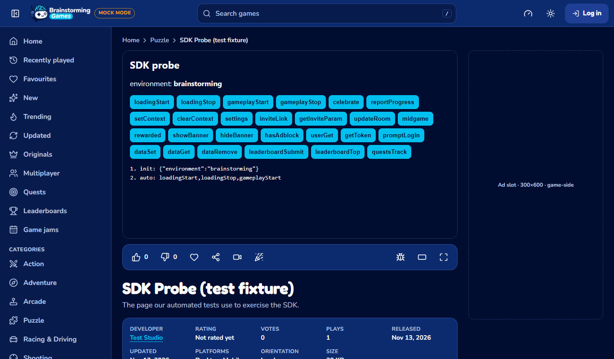
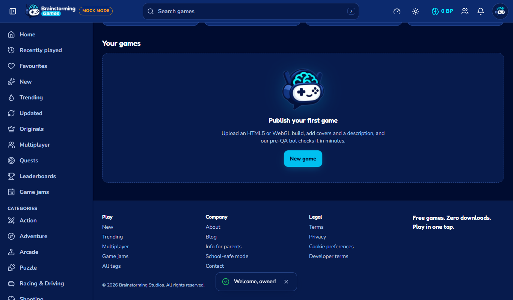
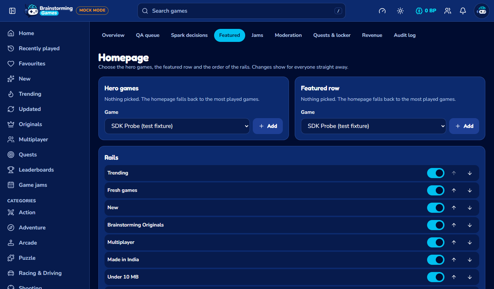
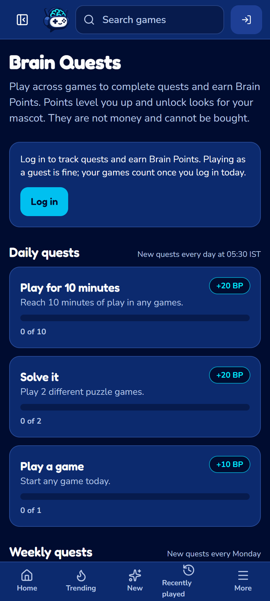

# Brainstorming Games

A free browser-game portal with a developer portal, an SDK and an admin console. Players open a
page and play; studios upload HTML5 or WebGL builds and earn a published share of ad revenue.

It runs with **zero setup**: with no environment variables the whole site works in mock mode,
with its data in your browser. The catalogue starts **empty**. Every game is added by its owner
through the developer portal; none are bundled, seeded or scraped.

| Home (empty catalogue) | Game page |
| --- | --- |
|  |  |

| Developer portal | Admin console | Quests on a phone |
| --- | --- | --- |
|  |  |  |

The game in the screenshots is the SDK test fixture from `tests/fixtures/sdk-probe`, added only
inside the screenshot browser session.

## Run it

Needs Node 20.11 or newer.

```bash
npm install
```

```bash
npm run dev
```

Open http://localhost:3000. The "Mock mode" badge means everything is local. Sign in with any
e-mail address; an address that starts with `admin@` gets the admin role (mock mode only).

To try the full loop: sign in, open `/dev/`, create a studio, upload a zip of a web build, run
pre-QA, submit; then sign in as `admin@example.test`, open `/admin/qa/` and approve it.

## Checks

```bash
npm run build
```

```bash
npm run lint
```

```bash
npm run typecheck
```

```bash
npm test
```

```bash
npm run e2e
```

`npm run e2e` tests the built static site, so build first. It uses an installed Chrome or Edge.

Current state: 70 unit and database tests and 18 end-to-end tests pass (desktop and Pixel 7).
Lint and typecheck are clean.

## What is in v1

- **Players:** home rails, categories, tags, search with typo tolerance, game pages, like and
  dislike with reasons, favourites, history, low-data mode, light and dark themes, school-safe
  mode with a PIN, offline page.
- **Accounts:** magic link (plus Google and Discord on Supabase), a birth-year age gate, parental
  consent by e-mail for minors, guest data merged on sign-in, data export and account deletion.
- **Progression and social:** Brain Quests, Brain Points (earned by playing only, never bought),
  levels, streaks, a locker with 30 avatar items, friends with live presence, party rooms with
  preset-phrase chat, leaderboards, cloud saves.
- **Developers:** studio signup, a game wizard with browser-side cover cropping, zip validation
  and upload, a pre-QA bot (desktop and Pixel 7), private previews, versions and rollback, KPIs,
  bug reports, devlogs, referral link, thumbnail A/B tests, playtest panel results, jams,
  statements with PDFs and payout details.
- **Admin:** QA queue and review, Basic Launch decisions with written reasons, homepage editor,
  jam manager, moderation (reports, bans, studio suspension, hiding devlogs), quest and locker
  editors, monthly revenue run, audit log.
- **SDK** (`@brainstorming/sdk`, 5.4 KB gzipped): ads with shared rules, saves, leaderboards,
  quests and invites. It is the only SDK on the platform; the rules are in
  [docs/SDK_RULES.md](docs/SDK_RULES.md). See [docs/SDK.md](docs/SDK.md).
- **Ads:** off until configured. Never over or inside the game frame, never on `/dev`, `/admin`
  or policy pages. Minors, visitors of unknown age and school-safe mode get non-personalised
  ads only.

The site is English-only in v1. The locale plumbing is still in place (`apps/web/src/i18n`), so
a language can be added later with a messages file and `npm run gen:routes`.

## Known gaps in v1

- **Performance:** Lighthouse mobile performance measured 65 to 80 on this laptop under simulated
  slow 4G, below the target of 90 (largest contentful paint about 5 s). Accessibility is 100,
  best practices 100, SEO 100. First-load JavaScript is 142 KB on the home page and 156 KB on a
  game page.
- **Live services are untested:** the Supabase data layer, Edge Functions, R2 uploads, AdSense
  and e-mail are written, type-checked and (for the SQL) tested against an in-process Postgres,
  but have never run against real accounts. Mock mode is what the end-to-end tests exercise.
- **Legal text is a draft:** the terms, privacy policy and developer terms need a lawyer's
  review. The pages say so.
- **Clip recording** was built against the browser API but not tested with a real capture
  prompt (the automated browser cannot answer it).

## How it fits together

```text
apps/web            Next.js 15 static export (no server). Pages are pre-rendered; live data is
                    fetched in the browser through one repository interface.
  src/lib/data      repo.ts (the interface), mock/ (localStorage), supabase/ (the real thing)
  src/lib/domain    pure rules: rating, Basic Launch, KPIs, revenue split, quests, A/B tests
  src/lib/sdk-host  the page's side of the SDK bridge (every message validated)
packages/sdk        the script games load; talks to the page with postMessage
packages/ui         shared components and the mascot
supabase            migrations 0001 to 0010 (row-level security on every table), Edge Functions
scripts             build, post-build (headers, redirects, sitemaps), pre-QA bot, budgets
tests               unit, database (PGlite) and end-to-end (Playwright)
```

Games run in a sandboxed iframe on a **separate origin**, so a game cannot read a player's
session. A game published after the last build is served by a client fallback page until the
next rebuild picks it up.

## Deploying and costs

[docs/DEPLOY.md](docs/DEPLOY.md) walks through Supabase, Cloudflare R2 and Cloudflare Pages, and
lists each free-tier limit with the point at which to upgrade. Running costs are zero on those
free tiers. Vercel's Hobby plan is not used: it does not allow commercial sites.

The build plan and the decisions behind it are in [docs/PLAN.md](docs/PLAN.md).
